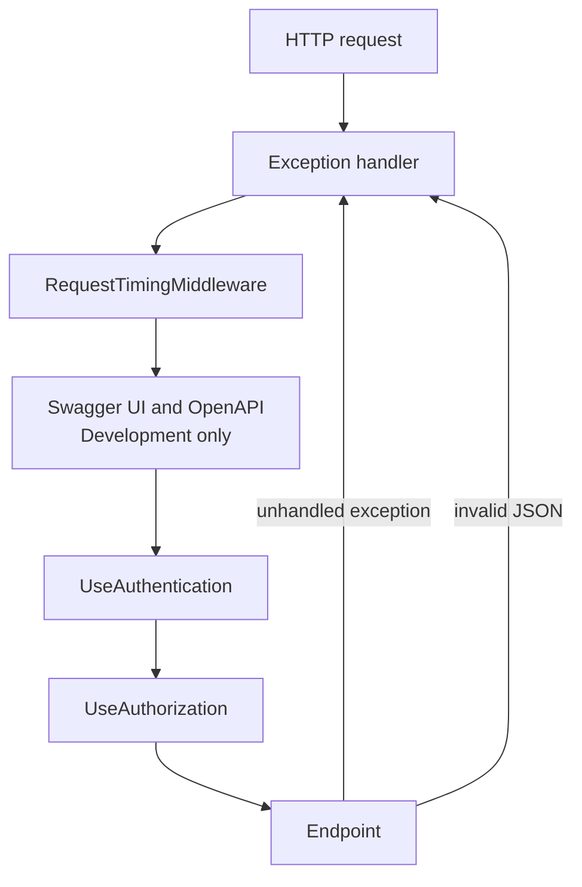
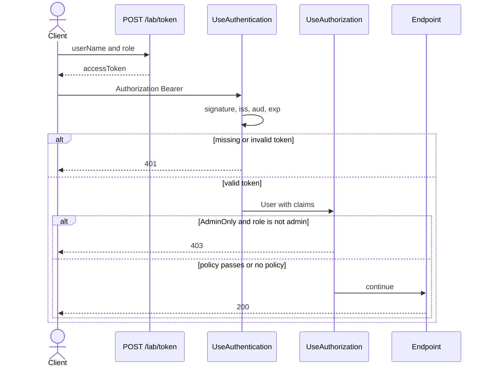
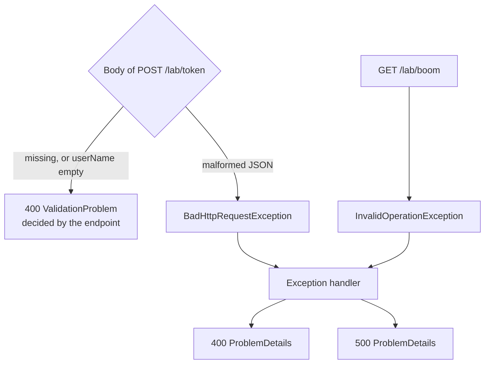

# lab-aspnet-core-webapi

ASP.NET Core API for the HTTP pipeline, dependency lifetimes, JWT access, configuration binding, and a single error contract.

.NET 10. HTTP on port **5065**. Swagger UI in Development: [http://localhost:5065/swagger](http://localhost:5065/swagger).

## Run

```powershell
dotnet run --project src/LabAspNetCoreWebApi.Api
dotnet test
```

Open `LabAspNetCoreWebApi.slnx` and start the `http` profile. The OpenAPI document is `/openapi/v1.json`. Swagger is not registered outside Development.

## Request map

`MapGet` and `MapPost` register endpoints. Order comes from middleware registration.



| Middleware | Responsibility |
| --- | --- |
| Exception handler | Turns failures from later stages into `application/problem+json`. |
| `RequestTimingMiddleware` | Logs method, path, status, and elapsed time after `next` returns. |
| OpenAPI / Swagger UI | Development only. |
| `UseAuthentication` | Validates the Bearer JWT and sets `HttpContext.User`. |
| `UseAuthorization` | Enforces `RequireAuthorization` and the `AdminOnly` policy. |

## Dependency injection lifetimes

`GET /lab/di` resolves the three lifetimes inside one scope. Call it twice.

| Lifetime | Registration | What the payload shows |
| --- | --- | --- |
| Transient | `TransientProbe` | The two ids in one response differ. |
| Scoped | `ScopedProbe` | The two ids in one response match. The next request gets a new pair. |
| Singleton | `SingletonProbe`, `LifetimeRegistry` | The id does not change. `createdCounts.singleton` stays at 1. |

A singleton must not hold a scoped service. Resolve scoped dependencies from `IServiceScopeFactory` at the point of use.

## Authentication and authorization

`POST /lab/token` issues an HMAC-SHA256 JWT. `userName` is required. The role claim is `admin` only when `role` is `admin`. Any other value, including a missing role, becomes `reader`. Issuer, audience, and signing key come from the `Jwt` section.

In Swagger, copy `accessToken` into **Authorize**.



| Call | Result |
| --- | --- |
| `GET /lab/secure` without a token | 401 |
| `GET /lab/secure` with `reader` or `admin` | 200 |
| `GET /lab/admin` without a token | 401 |
| `GET /lab/admin` with `reader` | 403 |
| `GET /lab/admin` with `admin` | 200 |

401 means the caller was not authenticated. 403 means the caller was authenticated and failed `AdminOnly`. The token is signed, not encrypted. Anyone can read the claims. They cannot change them without the signing key.

## Errors

Client input and server failures do not share a status code. Both use ProblemDetails where the handler writes the body.



`GET /lab/boom` exists to hit the 500 path. A 500 `detail` in this service is explicit.

## Blocking call

`GET /lab/anti-patterns/blocking` returns 200 and still blocks a thread on `GetResult()` until an asynchronous delay finishes. Under load that holds a thread-pool worker, queues unrelated requests, and slows the process. The fix is to `await` the work on the endpoint. Raising the thread-pool minimum does not remove the block.

## Endpoints

| Method | Path | Auth | Result |
| --- | --- | --- | --- |
| GET | `/health` | No | 200 liveness. No downstream checks. |
| GET | `/lab/di` | No | Lifetime ids and constructor counts. |
| GET | `/lab/options` | No | `Features` bound through `IOptions`. Startup snapshot. It does not reload. |
| POST | `/lab/token` | No | 200 JWT, or 400 when the body or `userName` is missing, or the JSON is invalid. |
| GET | `/lab/secure` | Bearer | 200 for any valid token. |
| GET | `/lab/admin` | Bearer + `admin` | 200, 401, or 403 as in the table above. |
| GET | `/lab/boom` | No | 500 ProblemDetails. |
| GET | `/lab/anti-patterns/blocking` | No | 200, with a thread blocked inside the handler. |

## Configuration

`appsettings.json` binds two sections:

| Section | Type | Notes |
| --- | --- | --- |
| `Jwt` | `LabJwtOptions` | Issuer, audience, signing key. |
| `Features` | `LabFeatureOptions` | Returned by `GET /lab/options`. `EnableVerboseTiming` is bound and is not read by the timing middleware. |

`IOptions<T>` is the startup snapshot. Use `IOptionsSnapshot<T>` per request, or `IOptionsMonitor<T>` when a singleton must observe changes. Do not inject `IOptionsSnapshot<T>` into a singleton.

The signing key in `appsettings.json` is a placeholder. Replace it from a secret store before any deployment. Do not reuse it.

---

I hope the practices in this repository help you ship APIs that fail in clearer ways, hold their threads for real work, and stay understandable six months later.

Sevann Radhak
